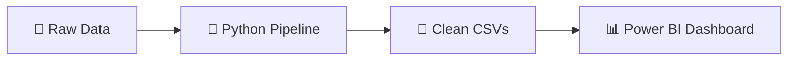

<div align="center">

# 🛒 Online Retail Analytics — Python & Power BI

### 📊 End-to-End Customer Analytics on the Online Retail II Dataset

[](https://www.python.org/)
[](https://pandas.pydata.org/)
[](https://numpy.org/)
[](https://scikit-learn.org/)
[](https://powerbi.microsoft.com/)
[](https://opensource.org/licenses/MIT)

**A reproducible Python pipeline for cleaning, RFM segmentation, and cohort analysis — paired with an interactive Power BI dashboard.**

[Overview](#-overview) • [Architecture](#-architecture) • [Python Pipeline](#-part-1--python-pipeline) • [Power BI Dashboard](#-part-2--power-bi-dashboard) • [Findings](#-key-findings) • [Contact](#-contact)

</div>

---

## 📖 Overview

An end-to-end customer analytics project built on the **Online Retail II** dataset. 

A reproducible **Python pipeline** handles data cleaning, RFM segmentation, and cohort analysis. A **Power BI dashboard** delivers interactive insights across four analytical views.

| 🎯 Goal | ✅ Result |
|:--------|:---------|
| Clean raw transactional data | Analysis-ready CSVs |
| Segment customers with RFM | 10 behavioral segments |
| Analyze retention over time | Cohort retention table |
| Deliver interactive insights | 4-page Power BI report |

---

## 🏗️ Architecture



| Layer | Tool | Output |
|:------|:-----|:-------|
| ETL & Feature Engineering | Python (pandas, numpy, scikit-learn) | 3 analysis-ready CSVs |
| Visualization | Power BI Desktop | 4-page interactive report |

---

## 🐍 Part 1 — Python Pipeline

### 🎯 Objectives
- Clean raw transactional data
- Compute RFM scores and assign customer segments
- Optionally cluster customers with **K-Means**
- Build cohort retention tables

### 🧹 Data Cleaning Rules

| Rule | Rationale |
|:-----|:----------|
| Drop duplicates | Raw file concatenates two years |
| Drop missing `CustomerID` | RFM requires customer identity |
| Remove cancellations (`C` prefix) | Exclude refunds |
| Keep `Quantity > 0`, `UnitPrice > 0` | Remove returns and errors |
| Remove non-product StockCodes | Postage, fees, adjustments |
| Normalize country labels | Ensure consistent geography |

### 📐 RFM Methodology

| Dimension | Definition | Score |
|:----------|:-----------|:------|
| **Recency** | Days since last purchase | 1–5 (5 = most recent) |
| **Frequency** | Distinct invoices | 1–5 |
| **Monetary** | Total spend | 1–5 |

> Scores computed via **quintiles**, with rank-based tie-breaking for Frequency and Monetary.

### 🎯 Segment Mapping

| Segment | Description |
|:--------|:------------|
| 🏆 Champions | Highest R, F, M |
| 💎 Loyal Customers | Consistent high-value buyers |
| 🌱 Potential Loyalists | Recent, moderate frequency |
| 🆕 New Customers | Very recent, low frequency |
| 🌟 Promising | Recent, low frequency, low spend |
| ⚠️ Need Attention | Mid-tier, declining |
| 😴 About to Sleep | Below-average engagement |
| 🚨 At Risk | Previously valuable, now inactive |
| 🛑 Can't Lose Them | High past value, now dormant |
| 💤 Hibernating | Lowest engagement |

### 📁 Outputs

| File | Description |
|:-----|:------------|
| `clean_transactions.csv` | Cleaned line-item transactions with segment labels |
| `rfm_segments.csv` | One row per customer with R/F/M scores and segment |
| `cohort_retention.csv` | Cohort × month retention and revenue |

### ⚙️ Requirements

```bash
pip install pandas numpy scikit-learn  # scikit-learn is optional — enables K-Means clustering
```

### 🚀 Usage

```bash
python pipeline.py
```

> Place `online_retail_II.csv` in a `Dataset/` folder alongside the script.

---

## 📊 Part 2 — Power BI Dashboard

### 📄 Report Structure

| Page | Purpose |
|:-----|:--------|
| 📈 Overview | Executive KPIs and segment distribution |
| 🎯 RFM Analysis | Customer value breakdown and RFM matrix |
| 📉 Cohort Trends | Retention curves and quarterly performance |
| 🌍 Geospatial | Geographic distribution of customers and revenue |

### 🔢 Headline Metrics

| KPI | Value |
|:----|:------|
| 💵 Average Order Value | **475.16** |
| 👥 Total Customers | **4K** |
| 💰 Total Sales | **9M** |
| 📦 Total Orders | **18K** |

### 🎯 Revenue Contribution by Segment

| Segment | Share |
|:--------|:------|
| 🏆 Champions | **49.32%** |
| 💎 Loyal Customers | **25.72%** |
| 🚨 At Risk | 7.24% |
| 💤 Hibernating | 5.90% |
| 🌱 Potential Loyalists | 5.78% |
| Others | 1.76% |

### 📉 Cohort Insights

- Retention falls from **100%** in month 1 to **~2.4%** in month 2
- **Q4-acquired** customers contribute **55.42%** of revenue
- The **2011 cohort** retains **~5× better** than 2010

### 🌍 Geographic Insights

- **United Kingdom** dominates both customer count and revenue
- Secondary markets: **Ireland, Germany, France, Netherlands**
- Long tail of **30+ countries** indicates expansion opportunity

---

## 💡 Key Findings

> **1.** 🏆 Champions and Loyal Customers generate **~75%** of total revenue.

> **2.** 🚨 At Risk and Hibernating segments account for **~13%** of revenue — a win-back priority.

> **3.** 📉 Retention collapses after month 2, highlighting an **onboarding gap**.

> **4.** 🗓️ Q4 acquisitions are **disproportionately valuable**.

> **5.** 🌍 The UK dominates, leaving **international markets largely untapped**.

---

## 🎯 Recommendations

| Priority | Action |
|:---------|:-------|
| 🏆 **Retain** | Launch a tiered loyalty program for Champions |
| 🔄 **Convert** | Build a 60-day onboarding journey to drive second purchases |
| 🎯 **Recover** | Run targeted win-back campaigns for At Risk customers |
| 🌍 **Expand** | Invest in the top 5 non-UK markets |
| ⚙️ **Sustain** | Automate monthly pipeline refresh and dashboard update |

---

## 📂 Repository Structure

```text
📦 Online_Retail/
 ┣ 📂 Dataset/
 ┃ ┗ 📄 online_retail_II.csv
 ┣ 🐍 pipeline.py
 ┣ 📄 clean_transactions.csv
 ┣ 📄 rfm_segments.csv
 ┣ 📄 cohort_retention.csv
 ┣ 📊 Online_Retail.pbix
 ┣ 📽️ Online_Retail.pptx
 ┗ 📜 README.md
```

---

## 🧰 Technology Stack

<div align="center">


</div>

| Component | Technology |
|:----------|:-----------|
| Data Processing | Python — pandas |
| Clustering | scikit-learn |
| Visualization | Power BI Desktop |
| Data Source | UCI Online Retail II |

---

## 🔁 Reproducibility

1. **Clone the repository**
   ```bash
   git clone https://github.com/your-username/Online_Retail.git
   cd Online_Retail
   ```

2. **Install Python dependencies**
   ```bash
   pip install pandas numpy scikit-learn
   ```

3. **Run the pipeline**
   ```bash
   python pipeline.py
   ```
   This regenerates all CSVs.

4. **Open the dashboard**
   - Open `Online_Retail.pbix` in Power BI Desktop
   - Click **Refresh** to load the latest data

---

## 🤝 Contributing

Contributions are welcome! Feel free to:

1. 🍴 Fork the repository
2. 🌿 Create a feature branch
3. 💾 Commit your changes
4. 🚀 Push and open a Pull Request

---

## 📜 License

This project is licensed under the **MIT License** — free to use and modify.

---

## 📧 Contact

<div align="center">

**Your Name**

[](mailto:abdallamohamed8354@gmail.com)
[](https://linkedin.com/in/abdalla-mohamed-farouk)
[](https://github.com/Abdalla820)

</div>

---

<div align="center">

### ⭐ If you found this project useful, please give it a star!

**Made with ❤️ using Python & Power BI**

</div>
